# For Anis 💗

A focus app made with love for Anis.

It blocks the apps that pull him away so he can study and get things done. Once
a session starts, there's no cancelling, no ending it early, and no
uninstalling — the only way out is to finish. Along the way it keeps him company
with little notes from me.

<p>
  
  
  
  
</p>

---

## A little gallery

<table>
  <tr>
    <td align="center">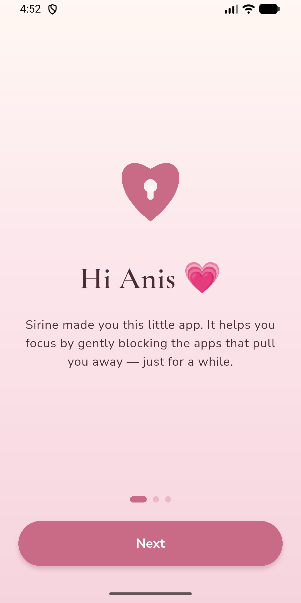<br><sub>Welcome</sub></td>
    <td align="center">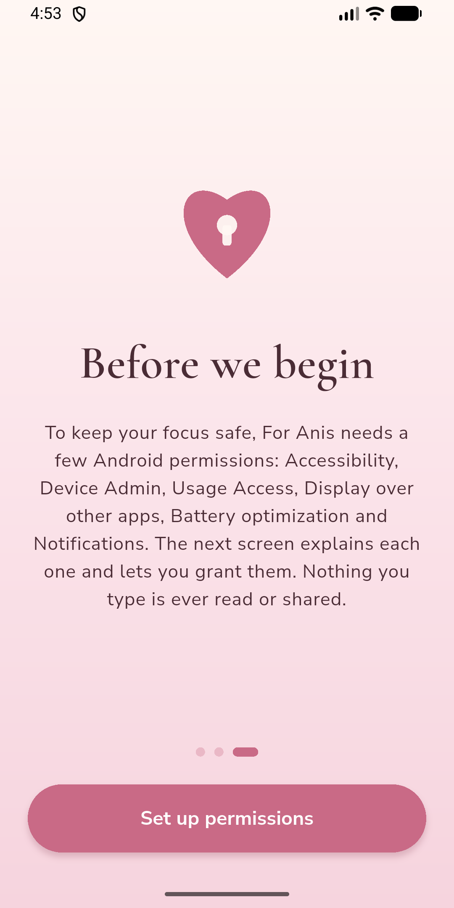<br><sub>Prominent disclosure</sub></td>
    <td align="center">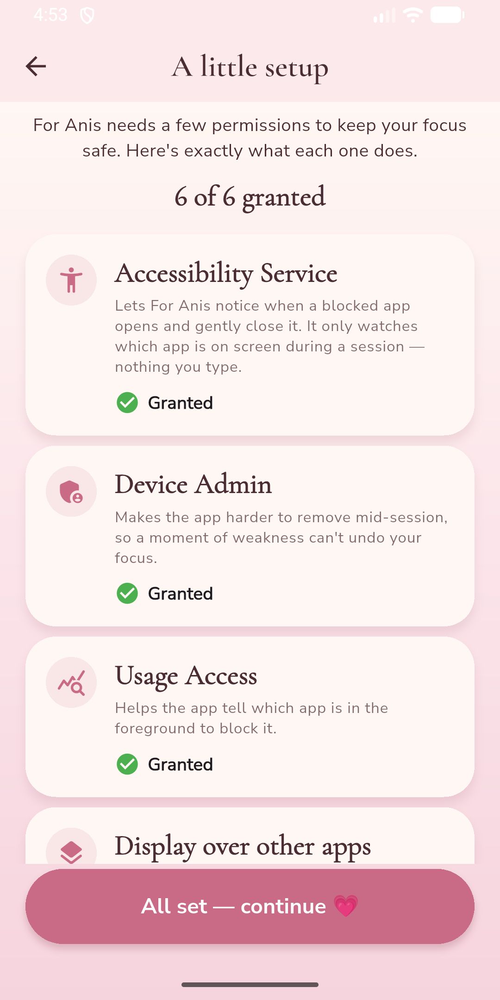<br><sub>Permission checklist</sub></td>
    <td align="center">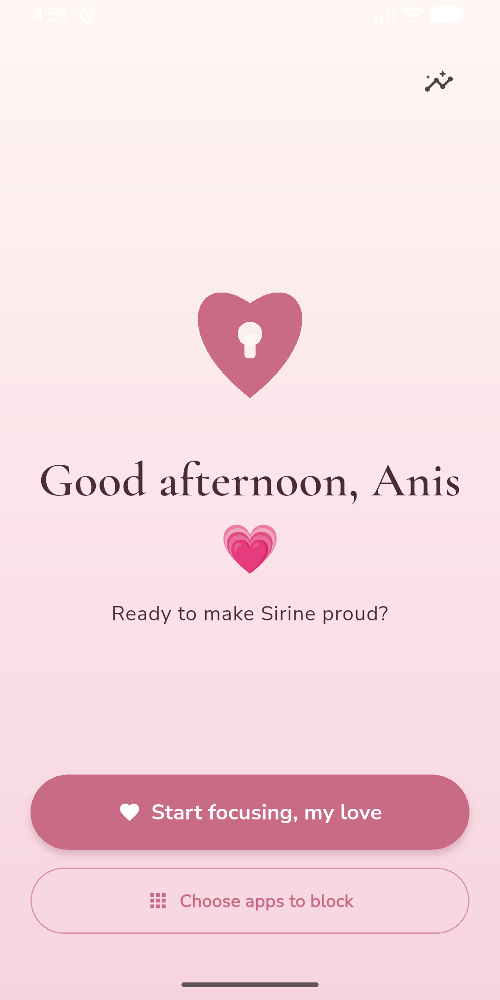<br><sub>Home</sub></td>
  </tr>
  <tr>
    <td align="center">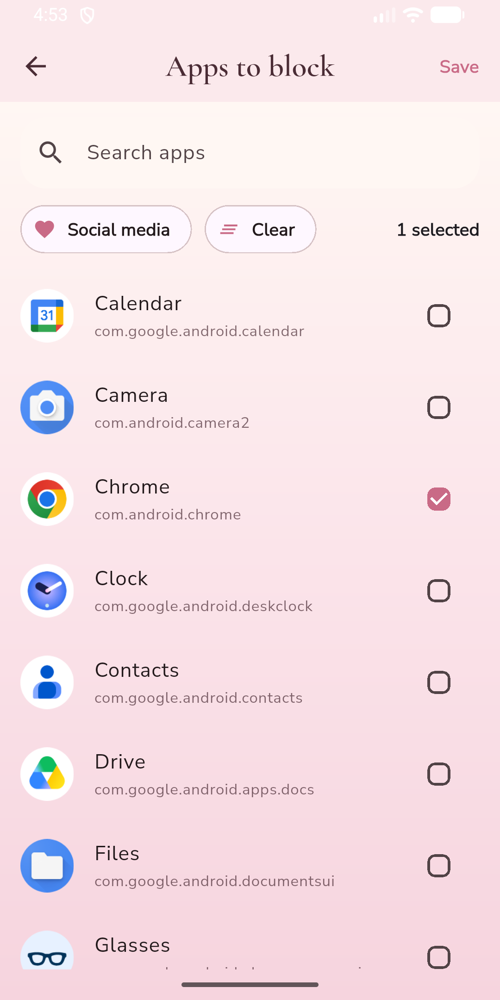<br><sub>App picker</sub></td>
    <td align="center">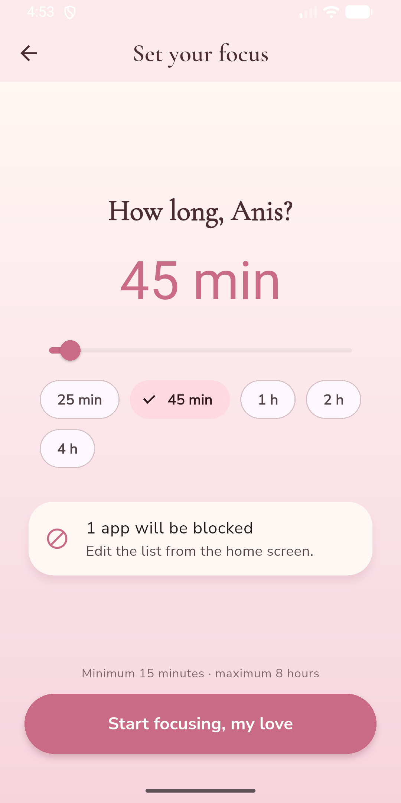<br><sub>Session setup</sub></td>
    <td align="center">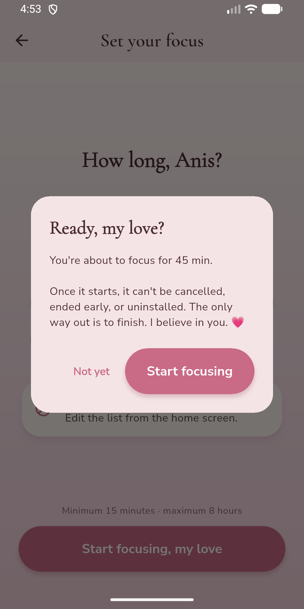<br><sub>No turning back</sub></td>
    <td align="center">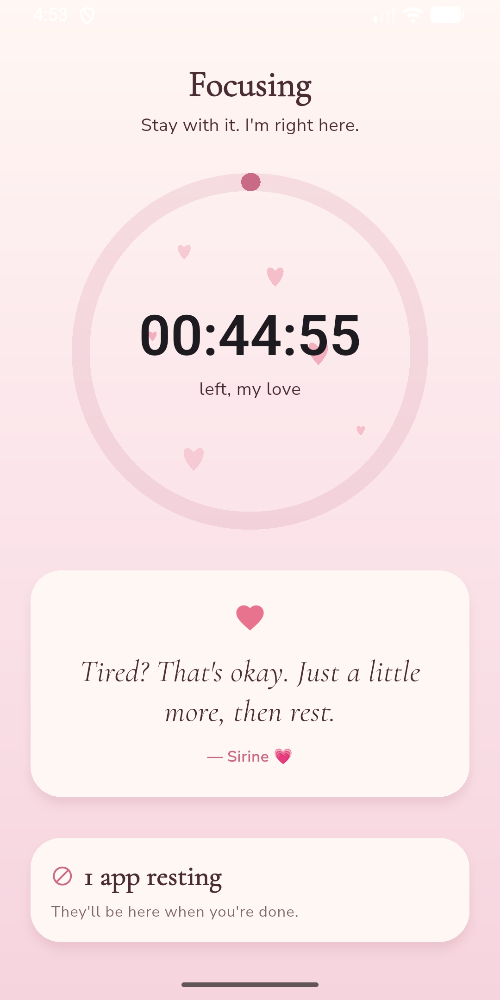<br><sub>Active countdown</sub></td>
  </tr>
  <tr>
    <td align="center">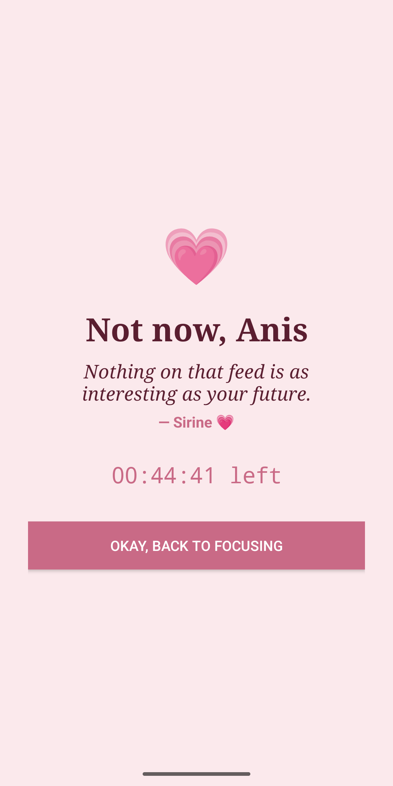<br><sub>Block screen</sub></td>
    <td align="center">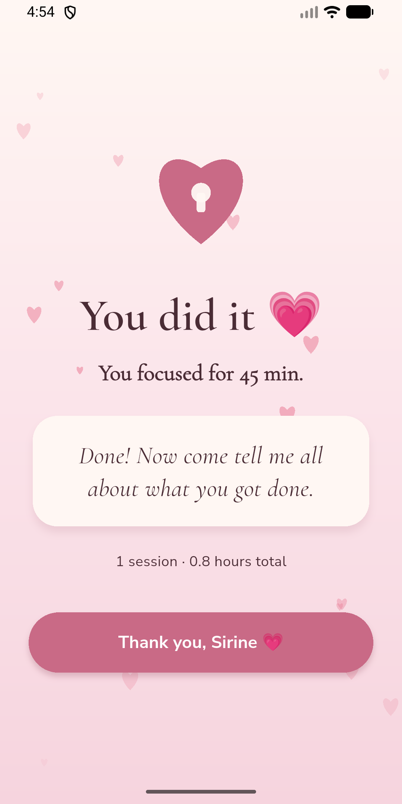<br><sub>Session complete</sub></td>
    <td align="center">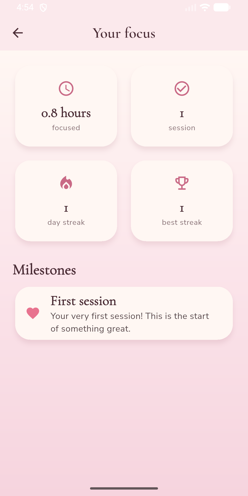<br><sub>Your focus</sub></td>
    <td align="center">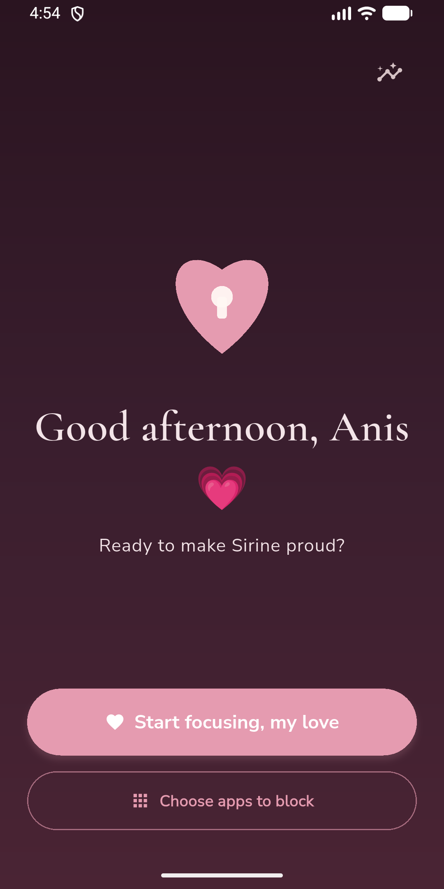<br><sub>Soft dark theme</sub></td>
  </tr>
</table>

---

## Features

- **Romantic by design** — blush, dusty rose and cream, an elegant serif for
  headings, soft cards and a gentle floating-hearts animation on the countdown.
  A soft burgundy/plum dark theme too.
- **Uncancellable sessions** — pick a duration (15 minutes to 8 hours) and
  confirm. After that there is no cancel button anywhere; the session simply has
  to run its course.
- **Real blocking** — a native Accessibility Service notices when a blocked app
  opens and immediately shows a full-screen block screen (with a love note and
  the time left), then sends Anis home.
- **Anti-escape guard** — during a session it bounces out of this app's App Info
  page, Device Admin, Accessibility and Date & Time settings, and uninstall
  dialogs for this app.
- **Cheat-proof timer** — the countdown is based on `SystemClock.elapsedRealtime`
  and the system boot count, so changing the clock does nothing and rebooting
  never shortens a session. A foreground service with a persistent notification
  keeps it alive, and a boot receiver restores it after a restart.
- **App picker** — all installed apps with their icons, search, and a one-tap
  "Social media" preset (Instagram, TikTok, Facebook, Snapchat, X, YouTube,
  Reddit, Telegram).
- **Love notes** — ~20 short messages from me, shown on the block screen,
  rotating on the active screen, and on the celebration screen. Easy to edit
  (see below).
- **Stats** — total focus time, sessions completed and a day streak, with sweet
  milestone messages.
- **Safe** — it never blocks the dialer, the default launcher, or itself, and it
  enforces the 8-hour maximum.

---

## How it works

The UI is Flutter (Clean Architecture + `flutter_bloc`). All the enforcement —
the cheat-proof timer, the blocking and the anti-escape — lives in native Kotlin.
The two talk over a `MethodChannel` (commands and queries) and an `EventChannel`
(a live stream of session state).

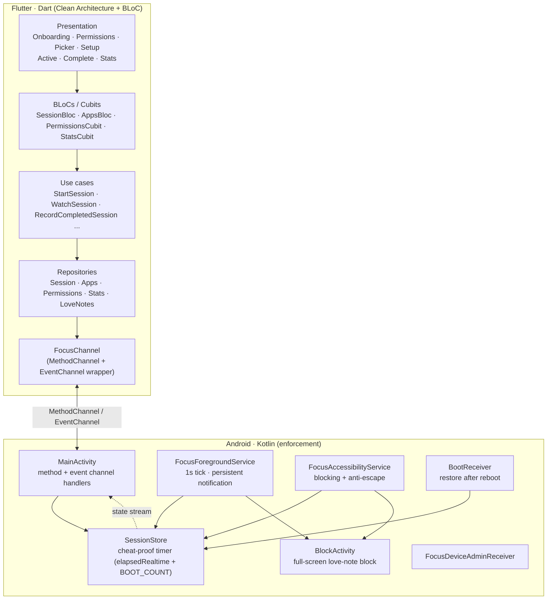

**The cheat-proof timer, briefly.** At the start we store the target time as
`elapsedRealtime() + duration` plus the current `Settings.Global.BOOT_COUNT`.
Within one boot the remaining time is just `target − elapsedRealtime()`, which
ignores wall-clock changes. The foreground service writes a checkpoint every
second. If a reboot is detected (the boot count changed, or `elapsedRealtime`
jumped backwards), we re-anchor to the remaining time from the last checkpoint —
the downtime is never credited, so a reboot can only ever make the session
longer, never shorter.

---

## Permissions, and why

Each one is explained in the app before it's requested (a prominent disclosure),
and a session can't start until all are granted.

| Permission | Why it's needed |
|---|---|
| **Accessibility Service** | To notice which app is in the foreground during a session and close a blocked one. It only reads which app is on screen — never what you type. |
| **Device Admin** | To make the app harder to uninstall mid-session. |
| **Usage Access** | To help identify the foreground app. |
| **Display over other apps** | To show the block screen instantly over a blocked app. |
| **Ignore battery optimization** | To keep the timer and foreground service reliable so a session isn't cut short. |
| **Notifications** | To show the persistent session notification with the time left. |

---

## Editing the love notes

All the messages live in [`assets/love_notes.json`](assets/love_notes.json) —
edit them there and rebuild. The file has four parts:

```json
{
  "signature": "— Sirine 💗",
  "notes": [ "Shown on the block screen and rotating on the active screen" ],
  "session_complete": [ "Shown on the celebration screen" ],
  "milestones": {
    "first_session": "...",
    "5_hours": "...",
    "10_hours": "...",
    "25_hours": "...",
    "50_hours": "...",
    "7_day_streak": "..."
  }
}
```

The notes are also mirrored to the native side on launch, so the block screen can
show one even when the Flutter engine isn't running.

---

## Build & run

Requirements: Flutter (stable), the Android SDK, and a device or emulator running
**Android 8.0 (API 26)** or newer.

```bash
flutter pub get
flutter run                 # debug on a connected device/emulator
flutter test                # unit + bloc + widget tests
flutter analyze             # static analysis (zero issues)
flutter build apk --release # release APK -> build/app/outputs/flutter-apk/
```

After installing, open the app and follow the onboarding to grant the
permissions, pick the apps to block, and start a session.

---

## Project structure

```
lib/
├── core/                 # theme, constants, errors, the platform channel, shared widgets
├── features/
│   ├── onboarding/        # welcome + prominent disclosure
│   ├── permissions/       # checklist (data / domain / presentation)
│   ├── apps/              # installed-app picker
│   ├── session/           # the heart: setup, active countdown, complete
│   ├── stats/             # focus stats + milestones
│   └── love_notes/        # loads love_notes.json, feeds the native cache
├── injection_container.dart  # get_it wiring
└── main.dart

android/app/src/main/kotlin/com/sirine/for_anis/
├── MainActivity.kt              # method + event channel handlers
├── SessionStore.kt              # cheat-proof timer + state
├── FocusForegroundService.kt    # persistent notification + 1s tick
├── FocusAccessibilityService.kt # blocking + anti-escape
├── BlockActivity.kt             # native full-screen block screen
├── FocusDeviceAdminReceiver.kt  # harder to uninstall
├── BootReceiver.kt              # restore after reboot
└── FocusEventBridge.kt          # pushes state to Flutter
```

---

## Known limitations

This raises the cost of giving up; it isn't unbreakable, and that's okay.

- **Safe Mode** boots Android without third-party apps, so the accessibility
  service won't run until you leave Safe Mode.
- **Factory reset** wipes everything, including this app and any active session.
- **`adb` / a computer** can uninstall the app or clear its data regardless of
  Device Admin.
- Reaching some OEM-specific settings screens may not always be caught by the
  anti-escape guard, which matches on known screen names and on-screen text.

---

## Distribution

Google Play's Accessibility and Device Admin policies restrict apps that prevent
their own uninstallation, so **For Anis isn't meant for the Play Store**. Install
it by sideloading the APK from the
[Releases](https://github.com/sirine2907/app-block/releases) page (enable
"Install unknown apps" for your browser or file manager first).

---

## License

MIT — see [LICENSE](LICENSE).

Made with love. 💗
